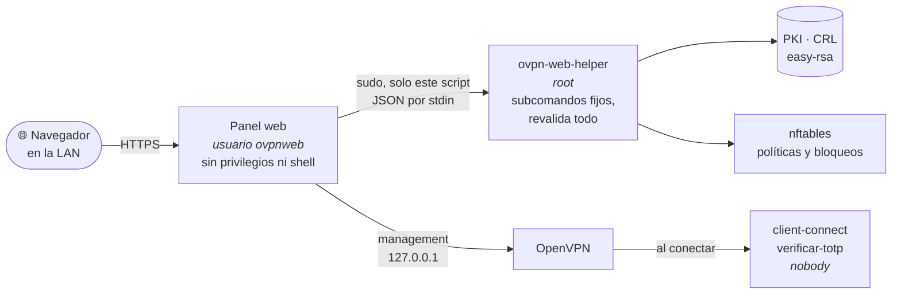

<div align="center">

[English](README.md) · **Español**

<picture>
  <source media="(prefers-color-scheme: dark)" srcset="app/static/imagenes/bridgesmgr-oscuro-transparente.png">
  
</picture>

# BridgesMGR

**El panel web para administrar tu servidor OpenVPN desde el navegador.**<br>
Clientes, políticas de acceso, verificación en dos pasos y endurecimiento,<br>
sin ceder root a una página web.

[](https://github.com/Electrobridges/BridgesMGR/actions/workflows/pruebas.yml)


[Instalación](#-instalación-rápida) ·
[Wiki de uso](docs/wiki/README.md) ·
[Seguridad](docs/seguridad.md) ·
[Cambios](CHANGELOG.md)

<br>


</div>

Se instala en el propio servidor VPN y se abre por su IP de la red local, por
ejemplo `https://192.168.1.192:55443`. Es la versión web de
[OpenVPN-Manager-CLI](https://github.com/Electrobridges/OpenVPN-Manager-CLI),
del que hereda el núcleo de parseo y comunicación con OpenVPN.

> [!NOTE]
> La interfaz del panel está en español y en inglés. El idioma se elige con el
> selector de la barra superior o con el idioma del navegador;
> `servidor.idioma` en `config.yaml` fija el idioma de la instalación, que es
> también el de los avisos por correo.

## ✨ Qué hace

<table>
<tr>
<td width="50%" valign="top">

### 👤 Clientes VPN
Crear, revocar, restaurar y descargar el `.ovpn` ya montado, con la clave
privada cifrada con contraseña por defecto. Desconectar a cualquiera al
momento. Aviso cuando un certificado está a punto de caducar.

</td>
<td width="50%" valign="top">

### ⏱️ Políticas de acceso
Por cliente: **acceso temporal** que se revoca solo, **horarios** por día,
**sesión máxima**, **cuota mensual** de tráfico, **IP fija** y **destinos
permitidos** en el cortafuegos.

</td>
</tr>
<tr>
<td valign="top">

### 📱 Dos pasos, en el panel y en la VPN
Código TOTP del móvil para entrar al panel y, cliente a cliente, también para
conectar a la VPN: un `.ovpn` robado deja de bastar.

</td>
<td valign="top">

### 🛡️ Endurecimiento
Auditoría del `server.conf` con nota sobre 100 y la línea que arregla cada
hallazgo, **bloqueo automático de IPs** con nftables y migración a
**tls-crypt-v2**.

</td>
</tr>
<tr>
<td valign="top">

### 📊 Vigilancia
Conexiones en vivo, gráficas de 30 días, historial de la VPN que sobrevive a
logrotate, avisos por correo o Discord y métricas para **Prometheus**.

</td>
<td valign="top">

### 👥 Cuentas y auditoría
Tres roles —`superusuario`, `admin` y `supervisor` de solo consulta— y
registro de quién hizo qué, cuándo y desde dónde, incluidos los logins
fallidos.

</td>
</tr>
</table>

## 📸 Capturas

<table>
<tr>
<td width="50%"></td>
<td width="50%"></td>
</tr>
<tr>
<td align="center"><sub><b>Clientes VPN</b> — cada política activa, de un vistazo</sub></td>
<td align="center"><sub><b>Políticas</b> — caducidad, horario, sesión máxima…</sub></td>
</tr>
<tr>
<td></td>
<td></td>
</tr>
<tr>
<td align="center"><sub><b>Seguridad</b> — la auditoría del <code>server.conf</code></sub></td>
<td align="center"><sub><b>Conexiones</b> — en vivo, cada 10 segundos</sub></td>
</tr>
</table>

<sub>Capturas de una instalación de pruebas con datos inventados.</sub>

## 🔐 Modelo de seguridad

Es un panel que puede revocar certificados y expulsar usuarios de una VPN, así
que conviene entender cómo está montado antes de instalarlo. La idea central:
**la web nunca es root**. Todo lo privilegiado cruza una sola puerta, estrecha
y que no se fía de quien llama.



| Decisión | Por qué |
|---|---|
| El servicio corre como `ovpnweb`, sin privilegios ni shell | Un fallo en la web no es root en el servidor VPN |
| Todo lo privilegiado pasa por `/usr/local/sbin/ovpn-web-helper` | Un único script cerrado, con subcomandos fijos, fácil de auditar |
| `sudoers` autoriza **solo ese script**, nunca `easyrsa` | `easyrsa` acepta `--pki-dir` y `--vars`: autorizarlo con comodines equivale a dar root |
| El helper lee sus rutas de `config.yaml` (root:ovpnweb 0640), jamás de sus argumentos | Si aceptara rutas del panel, un panel comprometido escalaría a root |
| El Common Name se valida a ambos lados de la frontera | El helper no se fía del panel aunque el panel ya valide |
| El panel **lee** el `server.conf` pero no lo escribe | Quien puede escribirlo ejecuta código como root; los arreglos se aplican a mano |
| Contraseñas con Argon2; en la base solo el SHA-256 del token de sesión | Robar el `.db` no da ni contraseñas ni sesiones |
| Verificación en dos pasos (TOTP), opcional para quien manda y exigible al rol supervisor | Una contraseña robada no basta para revocar certificados |
| El `superusuario` es la primera cuenta creada y nadie más puede tocarla, ni siquiera su contraseña | Si un admin pudiera cambiársela, entraría con ella: sería superusuario en dos pasos |
| Cookie `httpOnly` + `SameSite=Strict` + cabecera `X-CSRF-Token` obligatoria | Dos barreras independientes contra CSRF |
| CSP estricta `'self'`, sin CDNs ni scripts inline | HTMX y las gráficas se sirven desde el propio servidor |
| Bloqueo tras N intentos, contado por usuario+IP | Frena la fuerza bruta sin que un tercero pueda dejar fuera al admin |
| HTTPS con certificado autofirmado | Las credenciales no viajan en claro por la LAN |

> [!WARNING]
> **No expongas este panel a internet.** Está pensado para la red local o para
> llegar a él a través de la propia VPN.

El detalle completo, con las reglas que no se deben romper al modificar el
código, está en [docs/seguridad.md](docs/seguridad.md).

## 🚀 Instalación rápida

Requiere Debian 11+ o Ubuntu 20.04+ y Python 3.9+. **OpenVPN no hace falta
tenerlo ya**: si no lo encuentra, el instalador se ofrece a montarlo —PKI,
`server.conf` endurecido, NAT y todo— y luego rellena la configuración del
panel con lo que haya decidido. Si ya tienes un servidor, no le toca ni una
línea.

```bash
git clone https://github.com/Electrobridges/BridgesMGR.git
cd BridgesMGR
sudo bash deploy/install.sh
```

Después, **tres pasos obligatorios**:

```bash
# 1. Repasa la configuración (sobre todo cliente_ovpn.remote_host)
sudo nano /etc/ovpn-web/config.yaml

# 2. Crea la primera cuenta: será el superusuario (no hay usuario por defecto)
cd /opt/ovpn-web
sudo -u ovpnweb venv/bin/python -m app.cli crear-usuario tu_usuario --rol admin

# 3. Arranca
sudo systemctl start ovpn-web
```

Abre `https://TU_IP:55443`. El navegador avisará de que el certificado es
autofirmado: es lo esperado, acepta la excepción.

<details>
<summary><b>Actualizar</b></summary>

```bash
cd BridgesMGR
git pull
sudo bash deploy/install.sh
```

Repetirlo es siempre seguro. La versión nueva se prepara al lado y solo
sustituye a la que corre si importa bien y le vale tu `config.yaml`; si después
no arranca, el instalador **vuelve solo a la anterior** y dice por qué. Todo
queda en `/var/log/ovpn-web-instalacion.log`.

</details>

<details>
<summary><b>Si ya tenías un servidor OpenVPN</b></summary>

El panel no toca tu `server.conf`. Para saber qué le falta para encajar, sin
modificar ni reiniciar nada:

```bash
sudo bash deploy/comprobar-servidor.sh
```

Las líneas que necesita cada función —políticas, dos pasos en la VPN, IP
fijas— están en [docs/configuracion.md](docs/configuracion.md#lo-que-se-configura-desde-el-panel),
y la página **Seguridad** del panel las señala una a una.

</details>

Los requisitos del `server.conf`, la actualización y la desinstalación están en
[docs/instalacion.md](docs/instalacion.md).

## 📚 Documentación

| | |
|---|---|
| 📖 [**Wiki de uso**](docs/wiki/README.md) | **El día a día**: clientes, políticas, dos pasos, seguridad, vigilancia y mantenimiento |
| [Instalación](docs/instalacion.md) | Requisitos, `server.conf`, instalar, actualizar y desinstalar |
| [Configuración](docs/configuracion.md) | Todas las claves de `config.yaml`, con sus valores por defecto |
| [Seguridad](docs/seguridad.md) | La frontera de privilegios y las reglas que la sostienen |
| [Arquitectura](docs/arquitectura.md) | Cómo está montado por dentro y por qué |
| [Solución de problemas](docs/solucion-problemas.md) | Los fallos habituales y cómo diagnosticarlos |
| [Contribuir](CONTRIBUTING.md) | Entorno de desarrollo, estilo y pruebas |
| [Cambios](CHANGELOG.md) | Registro de versiones |

## 🧪 Desarrollo

```bash
python -m venv .venv
source .venv/bin/activate
pip install -r requirements-dev.txt

pytest
```

La suite corre entera en Windows o Linux, sin OpenVPN instalado. La mitad
privilegiada —el helper, el instalador, la regla de sudo y la unidad de
systemd— la prueba la integración continua sobre Ubuntu, con OpenVPN y systemd
reales. Ver [CONTRIBUTING.md](CONTRIBUTING.md).

## ⚖️ Licencia

**Apache License 2.0.** Ver [LICENSE](LICENSE) y [NOTICE](NOTICE).

Puedes usarlo, modificarlo y distribuirlo, incluso comercialmente. A cambio se
piden tres cosas: conservar los avisos de copyright y el contenido de `NOTICE`,
señalar los archivos que hayas cambiado, e incluir una copia de la licencia.

<details>
<summary>Patentes, marcas y material de terceros</summary>

Dos cosas que conviene saber, y que la licencia MIT no cubre:

- **Patentes.** Quien contribuye concede expresamente los derechos de patente
  necesarios para usar su aportación. Si alguien demanda al proyecto por
  patentes, pierde esa concesión.
- **Marcas.** «BridgesMGR» y «Electrobridges» son marcas de Daniel Puentes. La
  sección 6 de la licencia **no concede derecho a usarlas**: un derivado puede
  reutilizar este código, pero no presentarse con este nombre ni con esta
  identidad visual.

Material de terceros incluido en el repositorio, con su propia licencia (el
detalle completo, en [NOTICE](NOTICE)):

| Qué | Dónde | Licencia |
| --- | --- | --- |
| Poppins | `app/static/fuentes/` | SIL Open Font License 1.1 |
| Material Design Icons (vía `react-icons/md`) | `app/templates/partials/fondo_marca.html` | Apache License 2.0 |

</details>

---

<div align="center">

Hecho por **Daniel Puentes** · [Electrobridges](https://github.com/Electrobridges)

</div>
