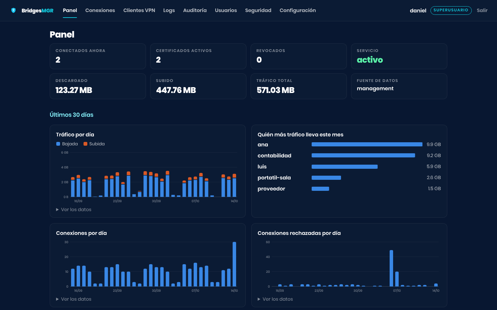
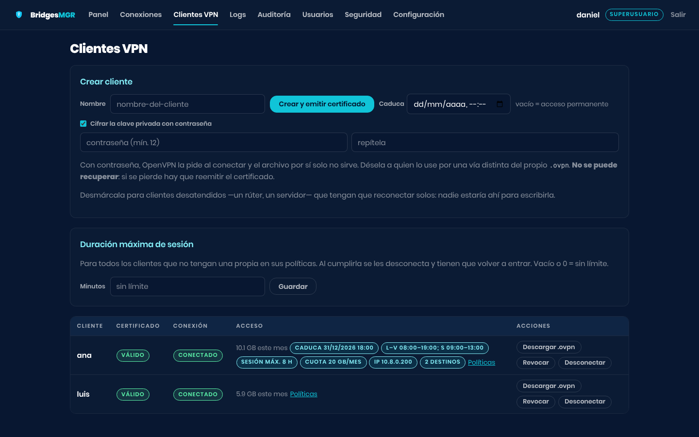
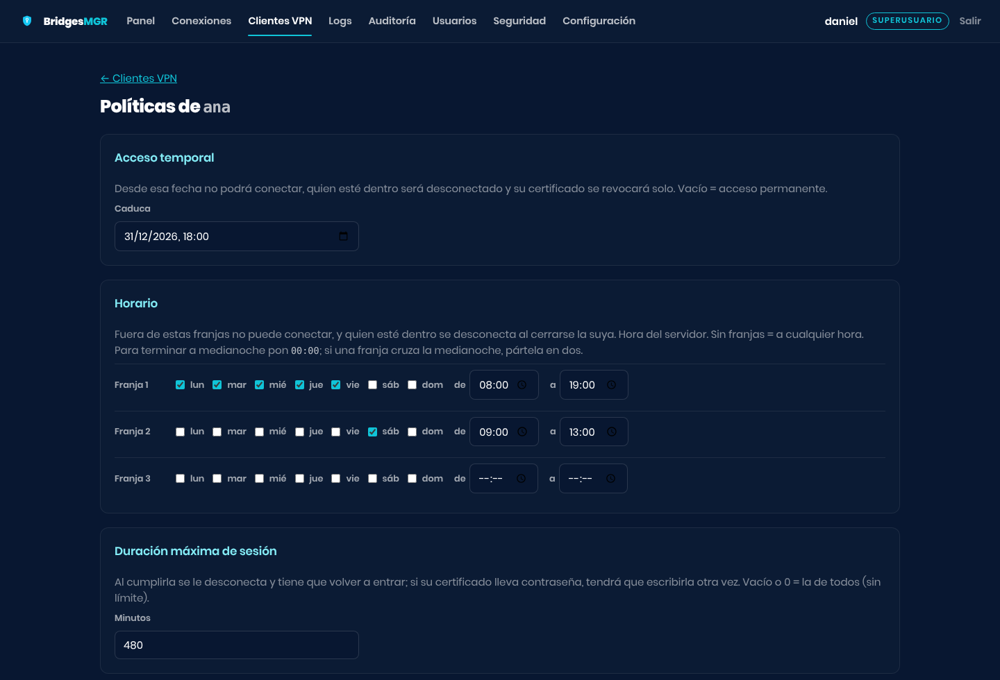
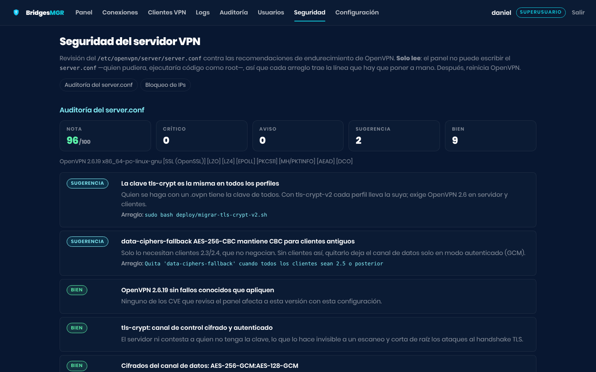
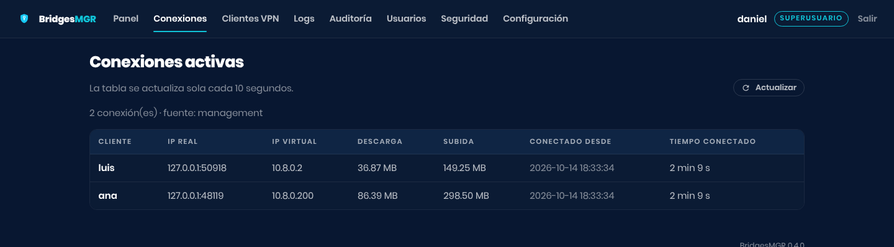
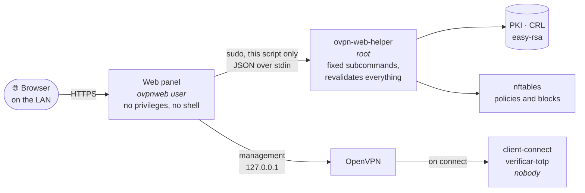

<div align="center">

**English** · [Español](README.es.md)

<picture>
  <source media="(prefers-color-scheme: dark)" srcset="app/static/imagenes/bridgesmgr-oscuro-transparente.png">
  
</picture>

# BridgesMGR

**The web panel for managing your OpenVPN server from the browser.**<br>
Clients, access policies, two-step verification and hardening,<br>
without handing root over to a web page.

[](https://github.com/Electrobridges/BridgesMGR/actions/workflows/pruebas.yml)


[Installation](#-quick-installation) ·
[Usage wiki](docs/en/wiki/README.md) ·
[Security](docs/en/security.md) ·
[Changelog](CHANGELOG.md) (Spanish)

<br>



</div>

It installs on the VPN server itself and is opened through its local network IP,
for example `https://192.168.1.192:55443`. It is the web version of
[OpenVPN-Manager-CLI](https://github.com/Electrobridges/OpenVPN-Manager-CLI),
from which it inherits the core parsing and communication with OpenVPN.

> [!NOTE]
> The panel's interface is in Spanish and English. The language is chosen with
> the selector in the top bar, or with the browser's language;
> `servidor.idioma` in `config.yaml` sets the language of the installation,
> which is also the one the email alerts are written in. This documentation is
> in English, and menu and button names are quoted as they appear on screen in
> the English panel.

## ✨ What it does

<table>
<tr>
<td width="50%" valign="top">

### 👤 VPN clients
Create, revoke, restore and download the ready-made `.ovpn`, with the private
key encrypted using a password by default. Disconnect anyone at any moment.
An alert when a certificate is about to expire.

</td>
<td width="50%" valign="top">

### ⏱️ Access policies
Per client: **temporary access** that revokes itself, **schedules** by day,
**maximum session length**, **monthly traffic quota**, **fixed IP** and
**allowed destinations** in the firewall.

</td>
</tr>
<tr>
<td valign="top">

### 📱 Two-step verification, for the panel and the VPN
A TOTP code from the phone to sign in to the panel and, client by client, to
connect to the VPN as well: a stolen `.ovpn` is no longer enough.

</td>
<td valign="top">

### 🛡️ Hardening
A `server.conf` audit scored out of 100 with the line that fixes each finding,
**automatic IP blocking** with nftables, and migration to **tls-crypt-v2**.

</td>
</tr>
<tr>
<td valign="top">

### 📊 Monitoring
Live connections, 30-day charts, VPN history that survives logrotate, alerts
by email or Discord, and metrics for **Prometheus**.

</td>
<td valign="top">

### 👥 Accounts and audit log
Three roles — `superusuario`, `admin` and read-only `supervisor` — and a record
of who did what, when and from where, including failed sign-ins.

</td>
</tr>
</table>

## 📸 Screenshots

<table>
<tr>
<td width="50%"></td>
<td width="50%"></td>
</tr>
<tr>
<td align="center"><sub><b>VPN clients</b> — every active policy at a glance</sub></td>
<td align="center"><sub><b>Policies</b> — expiry, schedule, maximum session length…</sub></td>
</tr>
<tr>
<td></td>
<td></td>
</tr>
<tr>
<td align="center"><sub><b>Security</b> — the <code>server.conf</code> audit</sub></td>
<td align="center"><sub><b>Connections</b> — live, every 10 seconds</sub></td>
</tr>
</table>

<sub>Screenshots from a test installation with invented data.</sub>

## 🔐 Security model

This is a panel that can revoke certificates and kick users off a VPN, so it is
worth understanding how it is put together before installing it. The central
idea: **the web app never runs as root**. Everything privileged crosses a single, narrow
door that does not trust whoever is calling.



| Decision | Why |
|---|---|
| The service runs as `ovpnweb`, with no privileges and no shell | A flaw in the web layer is not root on the VPN server |
| Everything privileged goes through `/usr/local/sbin/ovpn-web-helper` | A single closed script with fixed subcommands, easy to audit |
| `sudoers` authorises **that script only**, never `easyrsa` | `easyrsa` accepts `--pki-dir` and `--vars`: authorising it with wildcards is equivalent to handing over root |
| The helper reads its paths from `config.yaml` (root:ovpnweb 0640), never from its arguments | If it accepted paths from the panel, a compromised panel would escalate to root |
| The Common Name is validated on both sides of the privilege boundary | The helper does not trust the panel even when the panel already validates |
| The panel **reads** the `server.conf` but does not write it | Whoever can write it runs code as root; fixes are applied by hand |
| Argon2 passwords; only the SHA-256 of the session token in the database | Stealing the `.db` yields neither passwords nor sessions |
| Two-step verification (TOTP), optional for whoever is in charge and enforceable for the supervisor role | A stolen password is not enough to revoke certificates |
| The `superusuario` is the first account created and nobody else can touch it, not even its password | If an admin could change it, they would sign in with it: they would be a superusuario in two steps |
| `httpOnly` cookie + `SameSite=Strict` + mandatory `X-CSRF-Token` header | Two independent barriers against CSRF |
| Strict `'self'` CSP, no CDNs and no inline scripts | HTMX and the charts are served from the server itself |
| Lockout after N attempts, counted per user+IP | Slows brute force without letting a third party lock out the admin |
| HTTPS with a self-signed certificate | Credentials do not travel in cleartext over the LAN |

> [!WARNING]
> **Do not expose this panel to the internet.** It is meant for the local
> network, or to be reached through the VPN itself.

The full detail, including the rules that must not be broken when modifying the
code, is in [docs/en/security.md](docs/en/security.md).

## 🚀 Quick installation

Requires Debian 11+ or Ubuntu 20.04+ and Python 3.9+. **OpenVPN does not have to
be installed already**: if it is not found, the installer offers to set it up —
PKI, hardened `server.conf`, NAT and all — and then fills in the panel's
configuration with whatever it decided. If you already have a server, it does not
touch a single line of it.

```bash
git clone https://github.com/Electrobridges/BridgesMGR.git
cd BridgesMGR
sudo bash deploy/install.sh
```

After that, **three mandatory steps**:

```bash
# 1. Repasa la configuración (sobre todo cliente_ovpn.remote_host)
sudo nano /etc/ovpn-web/config.yaml

# 2. Crea la primera cuenta: será el superusuario (no hay usuario por defecto)
cd /opt/ovpn-web
sudo -u ovpnweb venv/bin/python -m app.cli crear-usuario tu_usuario --rol admin

# 3. Arranca
sudo systemctl start ovpn-web
```

Open `https://YOUR_IP:55443`. The browser will warn that the certificate is
self-signed: that is expected, accept the exception.

<details>
<summary><b>Updating</b></summary>

```bash
cd BridgesMGR
git pull
sudo bash deploy/install.sh
```

Repeating it is always safe. The new version is prepared alongside the running
one and only replaces it if it imports correctly and your `config.yaml` suits
it; if it does not start afterwards, the installer **goes back to the previous
one by itself** and says why. Everything is logged in
`/var/log/ovpn-web-instalacion.log`.

</details>

<details>
<summary><b>If you already had an OpenVPN server</b></summary>

The panel does not touch your `server.conf`. To find out what it is missing in
order to fit, without changing or restarting anything:

```bash
sudo bash deploy/comprobar-servidor.sh
```

The lines each feature needs — policies, two-step in the VPN, fixed IPs — are in
[docs/en/configuration.md](docs/en/configuration.md#what-is-configured-from-the-panel),
and the **Security** page of the panel points them out one by one.

</details>

The `server.conf` requirements, updating and uninstalling are in
[docs/en/installation.md](docs/en/installation.md).

## 📚 Documentation

| | |
|---|---|
| 📖 [**Usage wiki**](docs/en/wiki/README.md) | **Day to day**: clients, policies, two-step, security, monitoring and maintenance |
| [Installation](docs/en/installation.md) | Requirements, `server.conf`, installing, updating and uninstalling |
| [Configuration](docs/en/configuration.md) | Every `config.yaml` key, with its default value |
| [Security](docs/en/security.md) | The privilege boundary and the rules that hold it up |
| [Architecture](docs/arquitectura.md) (Spanish) | How it is put together inside, and why |
| [Troubleshooting](docs/en/troubleshooting.md) | The usual failures and how to diagnose them |
| [Contributing](CONTRIBUTING.md) (Spanish) | Development environment, style and tests |
| [Changelog](CHANGELOG.md) (Spanish) | Version history |

## 🧪 Development

```bash
python -m venv .venv
source .venv/bin/activate
pip install -r requirements-dev.txt

pytest
```

The whole suite runs on Windows or Linux, with no OpenVPN installed. The
privileged half — the helper, the installer, the sudo rule and the systemd unit
— is exercised by continuous integration on Ubuntu, with real OpenVPN and real
systemd. See [CONTRIBUTING.md](CONTRIBUTING.md) (Spanish).

## ⚖️ License

**Apache License 2.0.** See [LICENSE](LICENSE) and [NOTICE](NOTICE) (Spanish).

You may use, modify and distribute it, including commercially. In return three
things are asked: keep the copyright notices and the contents of `NOTICE`,
identify the files you changed, and include a copy of the license.

<details>
<summary>Patents, trademarks and third-party material</summary>

Two things worth knowing, which the MIT license does not cover:

- **Patents.** Contributors expressly grant the patent rights needed to use
  their contribution. If someone sues the project over patents, they lose that
  grant.
- **Trademarks.** "BridgesMGR" and "Electrobridges" are trademarks of Daniel
  Puentes. Section 6 of the license **does not grant the right to use them**: a
  derivative work may reuse this code, but may not present itself under this
  name or with this visual identity.

Third-party material included in the repository, under its own license (full
detail in [NOTICE](NOTICE) (Spanish)):

| What | Where | License |
| --- | --- | --- |
| Poppins | `app/static/fuentes/` | SIL Open Font License 1.1 |
| Material Design Icons (via `react-icons/md`) | `app/templates/partials/fondo_marca.html` | Apache License 2.0 |

</details>

---

<div align="center">

Made by **Daniel Puentes** · [Electrobridges](https://github.com/Electrobridges)

</div>