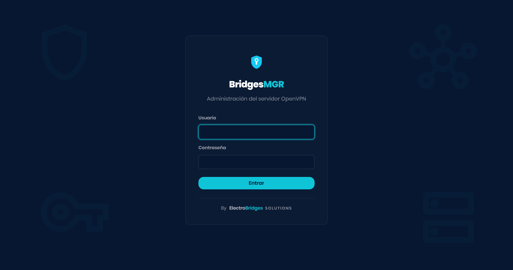
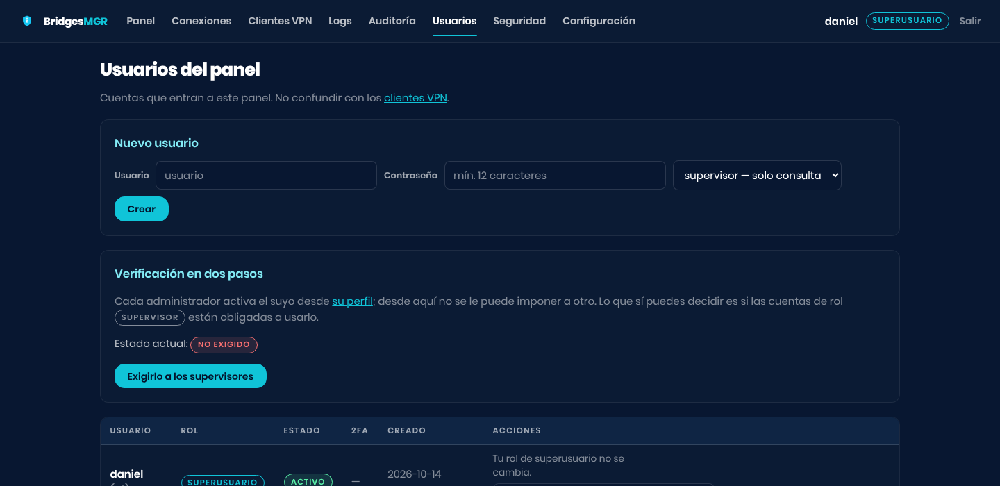

# 🚪 Getting started

**English** · [Español](../../wiki/primeros-pasos.md)

[← Wiki](README.md)

## Getting in

Open `https://SERVER_IP:55443` from the local network or from the VPN itself.
The first time, the browser warns that the certificate is self-signed: that is
expected, accept the exception.



The first account is created from the server, not from the web page (there is no
default user):

```bash
cd /opt/ovpn-web
sudo -u ovpnweb venv/bin/python -m app.cli crear-usuario tu_usuario --rol admin
```

That first account is the **superusuario** of the installation.

> [!NOTE]
> After five failed attempts from the same IP, that account is locked for
> fifteen minutes **for that IP only**: a third party cannot lock you out on
> purpose by getting it wrong.

## The menu

| Page | What is on it |
|---|---|
| **Panel** (Panel) | The state at a glance and the charts for the last 30 days |
| **Conexiones** (Connections) | Who is connected right now, with their IP and their traffic. It refreshes itself |
| **Clientes VPN** (VPN clients) | The certificates: create, download, revoke, policies |
| **Logs** | The OpenVPN log, colourised and filterable |
| **Auditoría** (Audit) | What was done in the panel and what happened on the VPN, kept in the database |
| **Usuarios** (Users) | The panel accounts |
| **Seguridad** (Security) | The `server.conf` review and IP blocking |
| **Configuración** (Settings) | Alerts, history retention and what the panel reads from `config.yaml` |

A `supervisor` does not see in the menu what they cannot use.

## The three roles

| Role | Can |
|---|---|
| `superusuario` | Everything, and nobody can touch their account. It is the first one created |
| `admin` | Everything on the VPN and manage the accounts, including other admins'; not the superusuario |
| `supervisor` | Look: panel, connections, clients, logs and audit, without a single button that changes anything. They do not get into *Usuarios* or *Configuración* |

A `supervisor` is what you give to someone who has to watch without being able
to break anything: support, an auditor, a colleague on call.



## Your two-step verification

Click **your name, at the top right**, to open your profile. From there you
enable the 2FA for your panel account: you scan a QR code with Google
Authenticator, Aegis or similar, and confirm with a code. From then on, the
password alone is not enough to sign in.

It is optional for the person in charge; in **Usuarios** (Users) it can be made
mandatory for `supervisor` accounts.

> [!IMPORTANT]
> This protects **the panel**. Asking clients **on the VPN** for a code is
> something else, and it is enabled client by client:
> [Two-step in the VPN](vpn-2fa.md).

---

Next: [👤 VPN clients →](clients.md)